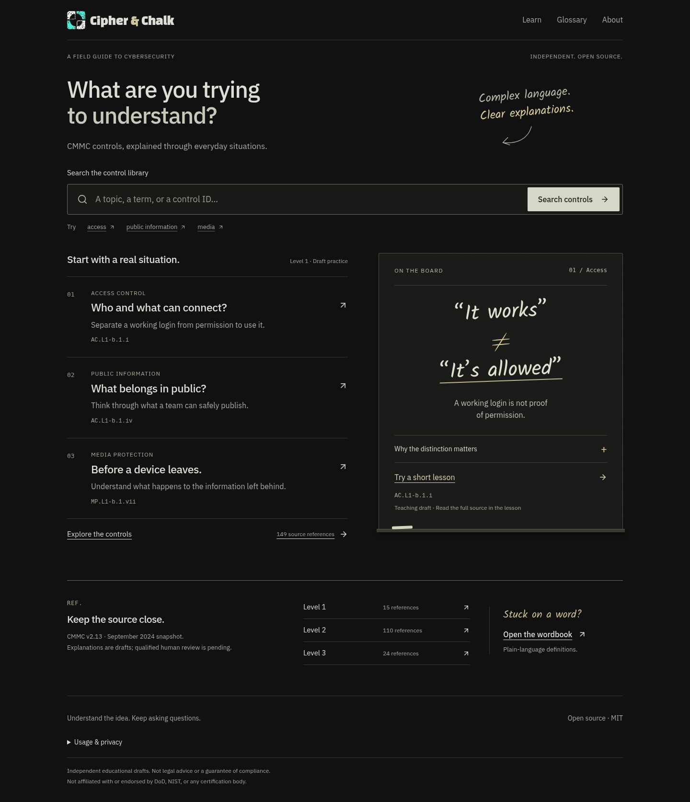

# Cipher & Chalk

**Complex compliance. Clear explanations.**

Cipher & Chalk is an open-source cybersecurity education project that turns
complicated frameworks, controls, and regulatory language into explanations people
can understand and use. We are starting with CMMC and building for a broader future.

[Visit the website](https://dummy-down.vercel.app) ·
[Explore the roadmap](docs/ROADMAP.md) · [Contribute](CONTRIBUTING.md) ·
[Report a problem](https://github.com/WaylandP/cipher-and-chalk/issues)



## Our mission

Make cybersecurity compliance accessible, understandable, and less intimidating
without changing the intent of the source material. Cipher & Chalk bridges dense
regulatory language and practical understanding through straightforward
explanations, relatable examples, and interactive learning.

## The problem we are solving

Understanding a cybersecurity requirement should not demand a dictionary, years of
experience, or an expensive consultant. For many people entering cybersecurity,
supporting a defense contract, or preparing a small business for an assessment,
that is exactly how it feels.

Frameworks such as CMMC and NIST publications contain dense terminology and ideas
that can be difficult to connect to day-to-day work. An IT administrator may know
how a system operates but not what an assessor is asking. A business owner may know
their organization but not the language of a control. A beginner may read the same
paragraph three times and still wonder what it means.

Understanding the requirement should be the beginning of the work, not the hardest
part of it.

## Who Cipher & Chalk is for

- People entering cybersecurity, IT, or compliance for the first time.
- IT administrators and security professionals taking on compliance work.
- Department of Defense contractors, subcontractors, and small businesses
  navigating federal cybersecurity requirements.
- Students, educators, and certification candidates.
- Compliance teams and experienced practitioners who need a clearer way to explain
  requirements to someone else.

If you have ever read a security control and thought, “Okay, but what does this
actually mean?”, this project is being built for you.

## How the platform teaches

Every available CMMC reference can be viewed from three perspectives. These are
educational drafts tied to the same source text, not three different requirements.

### Beginner

**“Explain it like I have never worked in cybersecurity.”**

Plain language, familiar situations, and practical distinctions without assuming
technical or compliance experience.

### IT & Cyber

**“I understand technology. Show me what this means in practice.”**

Technical context, possible approaches, operational tradeoffs, and limitations for
people who build, administer, or secure systems.

### Compliance

**“Help me understand what this requirement expects.”**

The official-source quotation stays visible alongside assessment questions,
possible evidence to discuss, and clear warnings about what the draft does not prove.
Evidence examples are not official assessment objectives or a guarantee of success.

The larger teaching vision includes realistic scenarios, diagrams, knowledge
checks, and short animated lessons for visual learners. Only the features described
as available below exist today; the rest remain roadmap ideas until implemented and
reviewed.

## What you can use today

- A responsive reference desk and Control Explorer for CMMC Levels 1, 2, and 3.
- Search and filters by identifier, topic, family, level, and content collection.
- Beginner, IT & Cyber, and Compliance teaching drafts for every catalog entry,
  displayed beside attributed source text and publication context.
- Shareable control-and-perspective links with browser Back/Forward support.
- An assessment coverage report with source statements, mapped draft explanations,
  level/gap filters, and explicit pending human review.
- A searchable 20-term draft glossary and contextual definitions in Level 1 lessons.
- Four draft learning activities with 12 explained questions: the original demo and
  three source-bound Level 1 activities covering authorized access, public
  information, and media disposal.
- Diagrams with text equivalents, loading/error recovery, review-status disclosures,
  source comparison, and optional privacy-preserving usage measurement.

There are currently no user accounts, organizational evidence uploads, compliance
scores, saved learning progress, or chatbot. Additional frameworks and animated
lessons are not available yet.

## Current CMMC coverage and review status

The catalog is a **September 2024 CMMC v2.13 publication snapshot**, with quotations
from the model and Level 1–3 assessment guides. Counts describe versioned source
identifiers, not distinct security concepts or professionally approved lessons.

<!-- content-summary:start -->

| Snapshot inventory      | Available |
| ----------------------- | --------: |
| Level 1 references      |        15 |
| Level 2 references      |       110 |
| Level 3 references      |        24 |
| Total references        |       149 |
| Draft perspective texts |       447 |

<!-- content-summary:end -->

The 149 official-source references have attributed page/version metadata. The 447
perspective texts are separately authored educational drafts bound to that edition.
Their existence, automated checks, and AI-assisted editorial review do **not** mean
they have received qualified human approval or complete assessment-objective review.

The [Level 1 editorial audit](docs/content-review/level-1-audit-2026-10-14.md) and
[Level 2/3 audit](docs/content-review/level-2-3-audit-2026-10-14.md) record AI-assisted,
control-by-control comparisons of all 447 perspectives with the pinned guides,
focused corrections and unresolved issues. All human-approval fields remain pending.
Thirteen statements are quoted as context for three learning activities. The
[assessment inventory](docs/sources/cmmc-objectives-2-13.md) preserves all 459
lettered determinations and nine organization-defined parameter statements.
The coverage page distinguishes mapped draft explanations from unresolved gaps;
it does not establish complete curriculum or assessment coverage. Qualified contributors can use the
[review packet](docs/content-review/QUALIFIED_REVIEW.md) to review individual controls.

The checked-in source snapshot came from pinned public mirrors with document
identity, page citations, and SHA-256 records. Direct access to the official DoD,
FAR/CFR, and NIST hosts was blocked in the source-check environment before an
origin response, so current official-host bytes and current applicability remain
external verification work. Read the [source provenance](docs/sources/cmmc-2-13-sep-2024.md)
and [editorial review process](docs/content-review/REVIEW_PROCESS.md) for the full
evidence and limitations.

## Project roadmap and current progress

The project still follows the original four phases:

1. **Build the Foundation** — the application, Explorer, framework-independent
   content identities, search, glossary, contribution workflow, and interface
   support for keyboards, responsive layouts, reduced motion, and forced colors are
   merged. Owner visual acceptance and real assistive-technology and learner
   validation remain open.
2. **Make CMMC Understandable** — the Level 1–3 source inventory and three draft
   perspectives per entry are implemented. Qualified review, current applicability
   checks, and comprehensive assessment-objective explanations are still in progress
   or externally blocked. This phase is not complete.
3. **Make Learning Interactive** — a small set of scenarios, diagrams, and quizzes
   is implemented as draft content. Broader exercises, learner validation, and short
   animated explanations remain planned. This phase is not complete.
4. **Expand the Platform** — the architecture and contribution guidance support
   future growth. NIST SP 800-53, FedRAMP, SOC 2, ISO/IEC 27001, HIPAA Security Rule,
   reviewed control relationships, and a sustainable community review process are
   future ideas, not available libraries or approved commitments.

See the [detailed roadmap](docs/ROADMAP.md) for milestone-level status,
[current priorities](TODOS.md) for the next actionable work, and the
[changelog](CHANGELOG.md) for verified changes merged into `main`. No completion
percentages are used: a phase is not finished merely because its interface exists.

Help validate the foundation with the [owner and learner acceptance checklist](docs/testing/PHASE_1_ACCEPTANCE.md).
Human acceptance and actual assistive-technology testing remain pending.

## Getting started and contributing

Cipher & Chalk uses React, TypeScript, Vite, and Tailwind CSS. You need Node.js
22.12 or newer; CI currently uses Node 24.

```sh
npm ci
npm run dev
```

Ideas, corrections, design improvements, source research, educational review, and
code contributions are welcome from beginners and experienced practitioners. Start
with the [contribution guide](CONTRIBUTING.md), which explains the development
workflow, content-review expectations, and rules for protecting sensitive data.

Maintainer commands, architecture, tests, deployment history, browser-review
records, and internal workflow evidence live in the
[development guide](docs/DEVELOPMENT.md), [deployment guide](docs/DEPLOYMENT.md),
[design notes](docs/DESIGN.md), and [review records](docs/reviews/). Keeping those
details outside this README leaves this page focused on the people the project
serves and where it is going.

## Source accuracy, security, and educational use

Simplifying a requirement must not silently change its intent. Cipher & Chalk keeps
official-source quotations separate from paraphrases, scenarios, possible evidence,
and other teaching material. Publication versions and review stages remain visible.
When source material changes, the goal is to identify and review the change rather
than quietly presenting a newer edition as interchangeable.

Automated tests can verify identities, counts, citations, fingerprints, and required
fields. AI-assisted review can compare drafts with source material and flag issues.
Neither replaces a qualified professional reviewing accuracy, applicability, and
educational quality.

Cipher & Chalk is an independent educational project. It is not affiliated with,
endorsed by, or certified by the Department of Defense, NIST, or any certification
body. Content is not legal advice, compliance certification, an assessment result,
or a guarantee of assessment success. Always consult the applicable official
requirements and assessment guidance.

Do not submit Controlled Unclassified Information (CUI), real organizational
evidence, credentials, personal information, or other protected data through the
application, issues, pull requests, or public contributions. The application does
not need that information to teach these concepts. Optional usage measurement
excludes raw searches, answers, copied links, organizational evidence, and
app-generated visitor identifiers; see [usage and privacy](docs/USAGE.md).

Official starting points:

- [DoD CMMC Program](https://dodcio.defense.gov/CMMC/)
- [DoD CMMC resources and documentation](https://dodcio.defense.gov/CMMC/Resources-Documentation/)
- [NIST SP 800-171 Rev. 2](https://csrc.nist.gov/pubs/sp/800/171/r2/upd1/final)
- [NIST SP 800-172](https://csrc.nist.gov/pubs/sp/800/172/final)

The application is licensed under the [MIT License](LICENSE). Source quotations
retain their attribution, and bundled font notices are in
[public/font-licenses](public/font-licenses). The application license does not grant
new rights over third-party publications.
