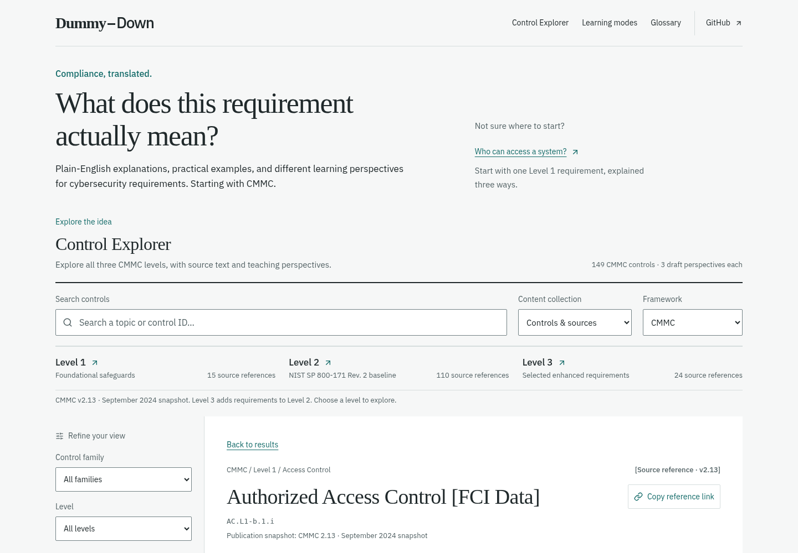

# Dummy-Down

**Compliance, translated.**

**What does this requirement actually mean?** Dummy-Down helps people understand
cybersecurity requirements through plain-English explanations, practical examples,
and different learning perspectives. Starting with CMMC.

[Visit Dummy-Down](https://dummy-down.vercel.app) ·
[Report a problem](https://github.com/WaylandP/Dummy-Down/issues) ·
[Contribute](CONTRIBUTING.md)

The public website returned the application successfully on October 13, 2026.
Feature work is reviewed in separate Vercel previews before an approved merge;
production and a pull request's preview can show different versions. See
[deployment and preview review](docs/DEPLOYMENT.md).



## What you can use today

- Browse CMMC Level 1, 2, and 3 source references; search by identifier, topic,
  family, or level.
- Switch between **Beginner**, **IT & Cyber**, and **Compliance** teaching drafts
  for every catalog entry. Read the official quotation alongside the explanation.
- Copy a link to a specific control and perspective. Search, filters, and browser
  Back/Forward preserve the reading context.
- Open contextual definitions and a searchable draft glossary.
- Try the original fictional authorized-access scenario and its three
  knowledge-check questions, with explanations for every answer.
- Use visible draft labels, edition/page citations, source comparison, and
  loading/error recovery to understand the limits of the material.
- Pause optional usage measurement through **Usage & privacy**.

For example, an approved account does not automatically approve every device that
uses it. A workplace scenario makes that distinction concrete; the source view
lets you check the full wording instead of treating the scenario as a checklist.

This is an early educational application. There are no accounts, organizational
assessment uploads, compliance scores, or chatbot. Other frameworks are planned;
their names in the interface do not represent available control libraries.

## Content coverage and review

The catalog is a **September 2024 CMMC v2.13 publication snapshot**, with quotations
from the model and Level 1–3 assessment guides. Counts describe identifiers in
that edition, not distinct security concepts or professionally reviewed lessons.

<!-- content-summary:start -->

| Snapshot inventory      | Available |
| ----------------------- | --------: |
| Level 1 references      |        15 |
| Level 2 references      |       110 |
| Level 3 references      |        24 |
| Total references        |       149 |
| Draft perspective texts |       447 |

<!-- content-summary:end -->

Each of the 149 references has three separately authored teaching drafts. The
original README-based Level 2 demo is a separate educational example and is not
counted as another official requirement. The glossary currently has six draft
terms; interactive practice currently covers that demo, not the entire catalog.

**Qualified human approval is pending.** Source transcription checks and
[AI-assisted editorial review](docs/designs/cmmc-perspectives-editorial-audit.md)
have occurred; neither establishes professional approval, complete assessment-
objective coverage, current applicability, or a guarantee of accuracy. The guide
and model have ten wording differences, preserved rather than silently reconciled.

Direct access to official DoD publication hosts was blocked in the source-check
environment. The stored PDFs came from pinned public mirrors, with document
identity, page citations, and SHA-256 checks recorded. The application presents the
dated snapshot; the latest applicable edition has not been independently verified.
Consult the official publications and your applicable contractual requirements.
See [source provenance and verification](docs/sources/cmmc-2-13-sep-2024.md).

## Roadmap

| Phase                            | Implemented or available drafts                                                                                                                   | Remaining work                                                                                                                                                                            |
| -------------------------------- | ------------------------------------------------------------------------------------------------------------------------------------------------- | ----------------------------------------------------------------------------------------------------------------------------------------------------------------------------------------- |
| **1. Build the foundation**      | React/TypeScript frontend, responsive Explorer, framework-independent identities, search, filters, sharing, glossary, tests and preview workflow. | Continue usability and accessibility checks with real learners; refine the proposed editorial identity through review.                                                                    |
| **2. Make CMMC understandable**  | Versioned Level 1–3 source inventory and three draft perspectives per entry, with practical examples and source links.                            | Qualified human approval, current applicability checks, explicit assessment-objective coverage and reviewed Level 1 lessons before broader curriculum claims. This phase is not complete. |
| **3. Make learning interactive** | A fictional demo scenario, a step-by-step visual flow, and three formative questions with answer explanations.                                    | Focused Level 1 scenarios, useful explanatory diagrams and linked vocabulary; later, short animated explanations and broader reviewed practice coverage.                                  |
| **4. Expand the platform**       | Framework-independent architecture and published contribution guidelines.                                                                         | Additional frameworks, reviewed relationships between controls and a sustainable community editorial process. No automatic equivalence claims or new framework libraries yet.             |

[TODOS.md](TODOS.md) keeps the next priorities aligned with this roadmap.

## Development

Use **Node.js 22.12 or newer**; CI uses Node 24. From the repository directory:

```sh
npm ci
npm run dev
```

Open Vite's printed local URL. A cloud environment with port forwarding can use
`npm run dev -- --host 0.0.0.0`. For owner review, use the pull request's Vercel
preview in a browser rather than a terminal or Codespaces.

Before pushing a change, run:

```sh
npm run typecheck
npm run lint
npm run format:check
npm test
npm run build
node scripts/check-content-summary.mjs
```

The last command checks the published inventory against repository data and
required source/teaching metadata. It does not judge compliance accuracy. Use
`npm run preview` to inspect an already built frontend locally.

- [Development guide](docs/DEVELOPMENT.md): architecture, addresses and checks.
- [Contribution guide](CONTRIBUTING.md): code, educational content and safeguards.
- [Source-review documentation](docs/sources/cmmc-2-13-sep-2024.md): edition,
  quotations, evidence and known limits.
- [Deployment guide](docs/DEPLOYMENT.md): GitHub CI, Vercel previews and production.
- [Design notes](docs/DESIGN.md): the proposed identity and interaction direction.

## Usage measurement

The official Vercel Analytics SDK integration is implemented with production-only
collection, an opt-out, browser privacy preferences, and allowlisted interactions.
It excludes raw search text, answer choices, full shared links, organizational
evidence, and app-generated visitor identifiers. Preview traffic is excluded.

**Account activation, custom-event entitlement, and actual dashboard data receipt
have not been confirmed.** Installing the SDK is not proof that analytics is live.
See [Usage measurement](docs/USAGE.md) for owner setup and measurement limits.

## Educational disclaimer and license

Dummy-Down's mission is to make cybersecurity compliance accessible,
understandable, and less intimidating without changing a requirement's intent.
It is an independent educational project, not affiliated with, endorsed by, or
certified by DoD, NIST, or any certification body. Draft explanations, fictional
examples, and possible evidence are not official requirements, legal advice,
certification, or a guarantee of assessment success.

Do not submit CUI, sensitive organizational evidence, credentials, personal
information, or other protected data through searches, issues, or contributions.

The application is licensed under the [MIT License](LICENSE). Source quotations
retain their attribution; bundled font notices are in
[public/font-licenses](public/font-licenses). The application's license does not
grant new rights over third-party publications.
