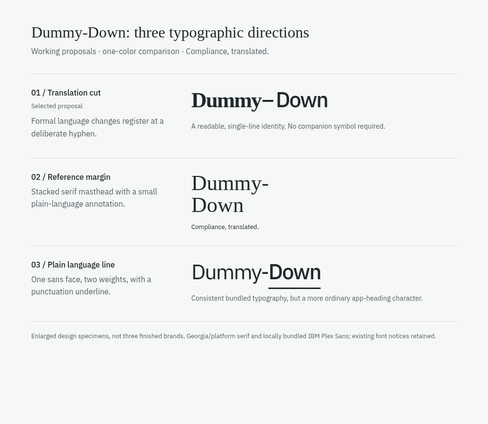

# Editorial identity proposal

Date: 2026-10-13. Branch: `feat/editorial-redesign-level-one`.

The owner rejected the earlier logo, tagline, dark theme and topographic
background. This proposal replaces the visual identity and composition while
preserving the educational purpose and working interactions. It remains open to
owner edits; implementation authorization is not final brand approval.

## Three wordmark directions

| Treatment                      | Visual idea                                                                                                             | Strength                                                                                               | Tradeoff                                                                                                  |
| ------------------------------ | ----------------------------------------------------------------------------------------------------------------------- | ------------------------------------------------------------------------------------------------------ | --------------------------------------------------------------------------------------------------------- |
| **Translation cut — selected** | Upright serif **Dummy**, a deliberately spaced horizontal hyphen, plain sans **Down**                                   | One readable name changes register from formal to approachable; works in one color and needs no symbol | Platform serif metrics vary by operating system, so spacing needs real phone/desktop review               |
| **Reference margin**           | Both words in an upright serif, stacked on two lines, with a small sans “Compliance, translated.” annotation            | A compact publication masthead with a strong editorial rhythm                                          | Takes more header height and puts attention on the brand before the working search                        |
| **Plain language line**        | One-line IBM Plex Sans wordmark at two contrasting weights; extended hyphen becomes a straight underline beneath “Down” | Consistent bundled font rendering and a direct punctuation idea                                        | More likely to resemble an ordinary app heading; the extra underline competes with interactive underlines |

These are materially different type/composition treatments, not icon or color
swaps. The chosen direction has no shield, circuit, contour mark or overlapping D
letters. “Dummy-Down” stays readable and literal. Its home link has the accessible
name “Dummy-Down home”; the styled duplicate is hidden from assistive technology.

The comparison is a browser-rendered HTML type specimen, inspected at 1000 × 870
on October 13, 2026. It enlarges the three treatments for comparison; the actual
selected header uses the smaller spacing and sizes in the application. The other
two are proposals rather than implemented alternate brands.

## Selected system

The serif/sans transition echoes the act of translation, while the interface
uses one bundled sans face for sustained reading and familiar controls. The
wordmark is charcoal in a single color. The companion favicon reduces to a simple
charcoal D with a large open counter on neutral off-white; it is an original SVG,
not a converted version of the rejected contour icon.

The palette is neutral `#f6f7f7`, white, charcoal `#20292b` and restrained teal
`#126a68`. The desktop introduction uses a short question on the left and a simple
reading invitation on the right. The working Explorer immediately follows.
Search has the broadest column. Control rows have square edges and a quiet tint;
the explanation area is white with comfortable line length. There are no hero
effects, rounded feature cards or decorative status badges.

IBM Plex Sans files and their SIL Open Font License were inspected locally.
Georgia / Times / generic serif are platform fonts and are not redistributed.
The Linux environment resolves Georgia to locally installed Noto Serif. Font
availability and differing metrics are explicit design constraints. No new font
dependency or external font request was introduced; existing notices remain.

## Review record

This record distinguishes implementation from later browser verification:

- Implemented: original accessible wordmark, one-color styling, neutral D favicon,
  updated metadata and a coherent CSS replacement.
- Calculated palette checks: foreground/canvas 13.84:1; muted/canvas 6.02:1;
  teal/canvas 5.95:1; field border/canvas 3.72:1. These support intended contrast;
  actual component states still require rendered inspection.
- Independent in-host code critique checked contrast and caught a homepage kicker
  selector mismatch; that mismatch was corrected. This is not a paid outside-model
  design review or a browser accessibility audit.
- Before/after browser screenshots, phone layout, favicon rendering, focus,
  enlarged text and interaction observations are recorded by the coordinating
  browser QA pass. Do not infer their result from this implementation note.

The installed gstack design-consultation guidance was read for applicable product
context, type verification, coherence and anti-template rules. No external design
service or competitor browser session was used. The comparison above was rendered
locally from HTML and licensed/platform typography, without image generation. The
owner delegated routine direction choices and authorized active documentation
updates; the working proposal is demonstrated through the actual application.
