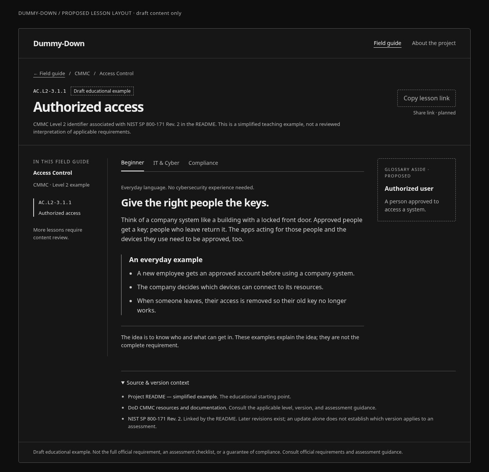
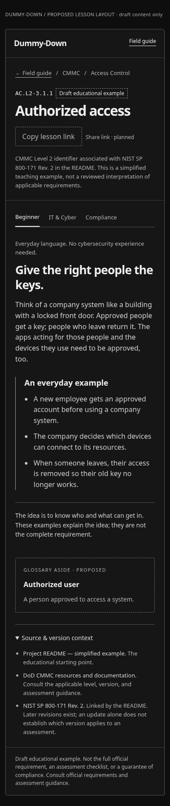

# Design: Dummy-Down as a cybersecurity field guide

> Historical record: its dark/topographic visual direction was superseded by the
> owner’s October 13, 2026 editorial redesign request. See [the active design
> system](../DESIGN.md). Prior functional/source review evidence remains scoped
> to the implementation and fingerprints recorded below.

Generated with gstack office-hours on 2026-10-13.

- Repository: `WaylandP/Dummy-Down`
- Branch: `chore/gstack-codex-workflow`
- Status: **DRAFT — autonomous planning complete; owner review pending**
- Mode: **Builder: open source and learning**
- Code inspected: `88be452f76812681f12006dc2a6d86a74c58c2c8`

The owner delegated the interview answers, premise decisions, and approach selection
to the agent, with review at the end. Answers below are grounded in the README and
stated preferences. Assumptions are proposals, not quotations from users or evidence
of demand. This document and its sketches propose future behavior; they do not add
features to the application or approve a merge.

## Problem and the experience worth building

The README's mission is to make cybersecurity compliance accessible, understandable,
and less intimidating. Its audience includes beginners, IT administrators, small
businesses, defense contractors, educators, and compliance teams. A useful first
experience is smaller than that entire audience: a person who has encountered a
security control and cannot explain what it means.

**Build a quiet field guide where someone can understand one concept, change
perspective without losing the concept, and share the same explanation with another
person.** A beginner and an IT colleague could read the same authorized-access lesson
through different lenses, then discuss what the example does and does not establish.
That conversation is the proposed moment of delight. It is a hypothesis to test,
not an observed result.

Keep the user's dark, spacious, professional topographic direction. The contours
can suggest navigation; the explanation itself should be the destination. Avoid a
wall of feature cards, glowing security-dashboard decoration, badges implying
certification, and decorative progress measurements.

## Office-hours questions, answered autonomously

| Question                                       | Answer and basis                                                                                                                                                                                                                                                                                         |
| ---------------------------------------------- | -------------------------------------------------------------------------------------------------------------------------------------------------------------------------------------------------------------------------------------------------------------------------------------------------------- |
| What is the goal?                              | Build a maintainable open-source educational resource while learning software development. Both goals were stated directly. Builder mode applies; fundraising and paid-customer diagnostics do not.                                                                                                      |
| What's the coolest version?                    | A field guide that connects everyday situations to a clear concept, its three perspectives, and authoritative sources. Eventually an educator could use one lesson to lead a discussion, and a colleague could send another person the exact perspective they need. This is an agent-selected direction. |
| Who would you show this to?                    | Start with a novice learner and an IT colleague interpreting the same example. The README supplies these audience categories; no specific person, interview, or willingness to pay has been established.                                                                                                 |
| What's the fastest useful or shareable result? | Make the existing draft lesson directly addressable and add a small contextual glossary. Use the existing example rather than manufacture a larger catalog. This lets a reader share something concrete while completing Phase 1 foundations.                                                            |
| What is closest, and how is this different?    | The source publications and assessment guides linked in the README are authoritative references. Dummy-Down's proposed contribution is the educational translation and perspective switching, with those references still available. No current competitor comparison was independently researched.      |
| What would unlimited time unlock?              | Reviewed lessons, diagrams, scenarios, knowledge checks, and carefully reviewed relationships across frameworks. These follow the README's later phases. They remain future work, with editorial review as a prerequisite.                                                                               |

## What exists, and what is still a proposal

Static inspection of the current code establishes the following boundary:

| Existing foundation                                                              | Future work                                                                                    |
| -------------------------------------------------------------------------------- | ---------------------------------------------------------------------------------------------- |
| React, TypeScript, Vite, Tailwind, locally bundled fonts, CI and Vercel previews | Backend, accounts, CMS, analytics and public production release decisions                      |
| Responsive homepage with restrained topography                                   | New discovery or reading layouts shown in the sketches                                         |
| Search, framework/family/level filters and recoverable empty states              | Restorable lesson URLs, a glossary and contextual term navigation                              |
| Beginner, IT & Cyber, and Compliance perspectives                                | Reviewed teaching content, quizzes and animated diagrams                                       |
| Exactly one draft educational example: `AC.L2-3.1.1`                             | Comprehensive CMMC coverage and content for other frameworks                                   |
| Draft labels, source links and prose version context                             | Structured content editions, explicit source kinds in the UI and real editorial review history |

Evidence: `src/App.tsx`, `src/components/ControlExplorer.tsx`,
`src/components/LearningModes.tsx`, `src/types/content.ts`, and `src/data/`.
The existing behavioral tests do not validate cybersecurity content accuracy. The
README's unchanged roadmap remains a statement of direction, not a release ledger.

## Constraints and premise decisions

- **Understanding comes before coverage.** More entries would make the catalog look
  larger, but unreviewed entries would not establish a trustworthy learning resource.
  Keep the single draft while making its reading experience useful.
- **A catalog alone may be too difficult for a beginner.** The independent product
  read challenged this premise. Preserve identifier search for experienced readers;
  propose an everyday-situation entry point later. Whether it improves comprehension
  remains untested.
- **Three modes are perspectives, not learner ranks or certification levels.** Keep
  Beginner, IT & Cyber, and Compliance. A person may switch among them for different
  purposes; do not split the combined technical mode or gate content by expertise.
- **Framework independence is necessary, but equivalence is not assumed.** CMMC
  levels must not become a universal taxonomy. Similar concepts across frameworks
  do not imply interchangeable requirements or assessment outcomes.
- **Static hosting is sufficient for the next slice.** The current content is small
  and public. Reuse the existing stack; introduce infrastructure only when an actual
  feature needs it.
- **Accuracy remains a separate human editorial dependency.** Link the applicable
  publications and identify versions. Neither passing tests nor an agent's review
  makes a draft official, complete, or reviewed by a qualified content reviewer.
- **Doing nothing leaves a working demonstration.** It also leaves glossary and
  shareable reading context unfinished. Improve those concrete limitations before
  adding accounts, assessment scoring, or a large redesign.

## Alternatives and selected approach

Effort estimates concern frontend work only. They are planning ranges, not promises;
content review timing is unknown. AI assistance does not remove that dependency.

| Approach                                             | Summary, reuse and tradeoff                                                                                                                                                                                                                                                                               | Effort / risk                                                                                                                                   |
| ---------------------------------------------------- | --------------------------------------------------------------------------------------------------------------------------------------------------------------------------------------------------------------------------------------------------------------------------------------------------------- | ----------------------------------------------------------------------------------------------------------------------------------------------- |
| A. Minimal Explorer refinement                       | Improve empty states, hide inapplicable level filters, and clarify source labels within the current component. Smallest diff and fastest polish; still leaves a learner unable to share a restorable lesson. Reuses all current UI and data.                                                              | Small; low implementation risk. Human: roughly 1–2 focused days; agent-assisted: roughly 1–2 work sessions including validation.                |
| B. Static field guide in small slices **(selected)** | Add stable lesson identity and URL state, then contextual glossary help. Preserve the existing visual system and three perspectives. Best foundation for later lessons and scenarios; requires explicit URL, focus and version behavior. Reuses the current data, search, modes and hosting.              | Medium; moderate state/content-model risk. Human: roughly 3–5 focused days; agent-assisted: roughly 2–4 work sessions including browser review. |
| C. Scenario-first learning lab                       | Start with a fictional employee departure and explain decisions before revealing related controls. Potentially memorable and useful for educators; requires new reviewed scenario content and feedback, and jumps into Phase 3 before completing Phase 1. Reuses the authorized-access example and modes. | Medium to large; higher editorial risk. Human: roughly 1–2 weeks; agent-assisted: several sessions plus content review of unknown duration.     |

**Choose B.** It turns the existing foundation into something useful to read and
share, satisfies the README's glossary direction, and leaves room for C's more
creative teaching approach. A's correctness refinements belong inside B. The owner
has not ruled out either alternative; selection was delegated to the agent and
remains editable during final review.

## Proposed information and visual design

The homepage should have one clear invitation to explore a concept, a short
explanation of the three perspectives, and a truthful early-development boundary.
Keep the sample entry visible and the contour illustration secondary. A long
feature list should not precede the first useful explanation.

The lesson should prioritize the concept, draft status, mode switch, explanation,
and one concrete example. Place source/version context close to the lesson; use a
disclosure for detail. Glossary definitions should open beside the reading context
on wide screens and inline on narrow screens, rather than navigating the learner
away. Prefer explicit term links over automatic tooltips on every technical word.

Maintain the colors and fonts in `docs/DESIGN.md`: dark canvas, quiet reading
surface, readable muted text, pale accent, Space Grotesk headings and IBM Plex Sans
body text. Use comfortable reading width, generous spacing, visible focus and
understated separators. Avoid adding new decorative families or mandatory motion.

The rough monochrome sketches below show proposed hierarchy, not production UI
or implemented functionality. The share-link and glossary affordances are planned.

## Architecture decisions for the next implementation

1. **Use an editorial identity separate from the official identifier.** Resolve a
   lesson by framework ID, content-edition ID and internal control key. Keep
   `AC.L2-3.1.1` as display/search data. The current bare control ID is insufficient
   across frameworks or revisions. For the sample, `readme-example` would name an
   editorial edition; it must not masquerade as an official CMMC version.
2. **Keep applicability explicit.** Structured source records should preserve
   publication title, revision, URL, source kind and applicability notes. A new NIST
   revision does not automatically establish which version applies to an assessment.
   Preserve the current draft's Rev. 2 basis until reviewed migration is justified.
3. **Start with native URL state.** A proposed address is
   `/?view=lesson&framework=cmmc&edition=readme-example&control=authorized-access&mode=beginner#explorer`.
   Use `URLSearchParams` and browser history, with pure parse/serialize helpers and
   React state. This avoids adding a routing dependency or path-rewrite requirement
   for the first slice. Reconsider a router when separate pages actually require it.
4. **Define navigation behavior before coding.** Use the URL state contract below
   for initial load, reload and Back/Forward, including discovery filters and an
   intentionally empty selection. Do not put disclosure or transient focus state
   into the URL. Explicitly subscribe to `popstate` and clean up listeners.
5. **Distinguish defaults from invalid addresses.** Only an initial address with
   no recognized state parameters can select the sample automatically. Incomplete
   and invalid explicit lesson identities never fall back to the first result.
   Planned frameworks remain truthful empty states.
6. **Separate discovery filters from lesson identity.** Store both explicitly in
   the URL, using `catalog` for the discovery framework and `framework` for the
   lesson framework. A deliberate filter change that excludes the selected lesson
   writes `view=discover` and removes its identity parameters. Restored or incoming
   valid lesson addresses retain their exact lesson even if supplied filters exclude
   it; show the mismatch and a clear-filters action rather than substituting a result.
7. **Keep glossary content separate and small.** Start with a few terms needed by
   the existing sample, such as authorized user, device and offboarding. Give each a
   stable ID, educational definition and source/version context. Reference term IDs
   explicitly from lessons; report a missing term gracefully. Definitions remain
   drafts until reviewed. Do not expand control search to glossary prose implicitly.
8. **Preserve honest source semantics.** Distinguish project explanations, official
   publications and official resource indexes; the current DoD index is not a
   requirement document. Render the distinction. Replace the hardcoded “Paraphrase
   from our README” label with provenance-driven wording when sources expand.
9. **Keep review state factual.** The current model allows only `draft`. Add a
   reviewed state only alongside a real workflow recording reviewer, reviewed
   edition, date and scope. A source link alone cannot advance this state. Check
   redistribution rights before incorporating licensed framework material; link
   authoritative text instead of assuming the repository's MIT license covers it.
10. **Reuse the smallest adequate tools.** Keep client-side search, TypeScript data,
    native form controls and the existing tests. No backend, CMS, global state
    library, search service or AI generation is needed for this slice. Render
    editorial text as text, not untrusted HTML.

### URL state contract

This is proposed behavior for implementation. The two explicit states are
`view=lesson` and `view=discover`. A lesson requires the full `framework`, `edition`
and `control` identity. A discovery address contains none of those three parameters;
`view=discover&catalog=cmmc&q=access` means there is intentionally no lesson selected.
Reload and history restoration preserve that absence rather than reopening the sample.

Discovery state lives in URL parameters: `catalog` (framework), `q` (search),
`family` and `level`. Missing `q`, `family` and `level` mean no constraint. Every
valid lesson address with an absent `catalog` defaults it to the lesson's framework,
including addresses containing `q`, `family` or `level`. Validate family and level
against that resolved catalog and retain search text. A direct lesson link with no
discovery parameters therefore starts unfiltered in its own framework. A discovery
address without `catalog` defaults to the existing CMMC preview. No external storage
is required for reload or cross-tab restoration.

| Address condition                                                                                  | Deterministic outcome                                                                                                                                                                                                  |
| -------------------------------------------------------------------------------------------------- | ---------------------------------------------------------------------------------------------------------------------------------------------------------------------------------------------------------------------- |
| No recognized state parameters                                                                     | Show the homepage and default sample in Beginner mode; serialize the explicit default state when navigation begins. Unrecognized parameters alone do not identify a lesson.                                            |
| Any recognized state parameter but missing `view`, or an unknown/empty `view`                      | Show an invalid-link state with a reset-to-discovery action; do not infer a lesson or fill an incomplete identity.                                                                                                     |
| `view=lesson` with a missing or empty identity field                                               | Show an incomplete-link state and preserve the address for diagnosis; offer discovery. No partial default completion.                                                                                                  |
| Unknown framework, edition or control in a complete lesson identity                                | Show not found for that address. A known planned framework explains that lesson content is unavailable. No result fallback.                                                                                            |
| `view=discover` plus any lesson identity field                                                     | Reject the conflicting state with a recovery action. An intentionally cleared selection never retains hidden lesson identity.                                                                                          |
| Repeated recognized parameter, even with equal values                                              | Reject the ambiguous link. Never silently choose first or last; the recovery action constructs a fresh valid discovery URL.                                                                                            |
| Malformed percent encoding in a recognized key/value, or unsupported characters in an identity key | Reject the link before resolving content. Decode once with a validating helper; framework, edition and internal control keys use stable lowercase letter/digit/hyphen slugs. Official identifiers remain display data. |
| Missing mode                                                                                       | Use Beginner.                                                                                                                                                                                                          |
| Unknown or empty mode                                                                              | Use Beginner with a visible normalization notice; replace the invalid mode with `beginner`. This does not change lesson identity.                                                                                      |
| Missing/empty search, family or level                                                              | Treat as no constraint and omit empty values when writing the URL. Natural-language search accepts Unicode and renders as text.                                                                                        |
| Unknown or empty `catalog`                                                                         | Show a recoverable discovery-framework error; do not silently search another framework.                                                                                                                                |
| A family or level unavailable in the known catalog                                                 | Clear that constraint, show a normalization notice and replace its URL value. A no-level framework has no Level filter.                                                                                                |
| Unrecognized parameters                                                                            | Ignore them and omit them from URLs written by the app. They never override recognized state.                                                                                                                          |

Deliberate lesson selection, mode selection, filter selections and return to discovery
use `pushState`. Debounced search edits use `replaceState`; if an edit excludes the
selected lesson, the same replacement switches to `view=discover`, removes the
identity and announces why. Updating URL and React state is one transaction.
Back/Forward reparses the complete URL; it does not combine a restored lesson with
stale filters from React state. Dismissing a glossary definition changes neither.

Opening a lesson from results retains discovery parameters. “Back to field guide”
writes `view=discover` with those same parameters and no lesson identity, so search
and filters are restored even when there is no prior history entry. A valid direct
lesson address with filters that exclude its lesson still shows that exact lesson
and a discovery-mismatch notice. A subsequent deliberate filter edit follows the
clear-selection rule; history replay alone never clears it.

“Copy lesson link” serializes `view=lesson`, the complete `framework`, `edition`
and `control` identity, current mode and `#explorer`, excluding discovery filters
and search text. Its output must parse as a valid explicit lesson state. The
recipient starts with unfiltered discovery in that lesson's framework. Keep copy
failure recoverable with a selectable link fallback; do not claim success if
clipboard access fails.

## Interaction and content acceptance criteria

These are proposed checks for future implementation, not claims that it passes now.

- A copied lesson link includes `view=lesson` and parses as a valid explicit lesson
  state, opening the intended framework, editorial edition, control and perspective;
  reload and Back/Forward retain the expected context.
- Missing, malformed, duplicate and unknown URL parameters have deterministic
  behavior. Invalid lesson identities never resolve silently to a different lesson.
- Search still supports combined filters, case-insensitive all-word matching, clear
  recovery and accurate result counts. Define the searched fields explicitly.
- A framework with no levels works without a CMMC-shaped identifier or visible
  Level filter. Two editions can contain the same official identifier safely.
- A glossary term can be opened and dismissed with keyboard and touch. Focus returns
  to its invoking link; the selected mode, lesson and discovery filters remain intact.
- Long titles, zero results, unavailable lessons and missing glossary references have
  readable states at desktop, tablet, 390px phone and landscape widths.
- Three mode tabs retain their current arrow/Home/End navigation and visible selected
  state. Labels, status announcements and focus placement explain state changes.
- Text remains readable at 200% zoom; interactions have adequate targets and contrast.
  Any motion respects reduced-motion preferences. Check real layouts, not only tokens.
- Draft status, educational/official distinctions and applicability context remain
  visible in every mode. Evidence examples never imply sufficiency or certification.
- Test parsing/history behavior and meaningful user journeys. Run lint, formatting,
  tests and production build; inspect the final browser flows. Content accuracy
  requires its separate editorial review.

## Roadmap and reviewable delivery slices

| Order                             | Concrete result                                                                                                                                                                    | Gate before the next slice                                                                                                                       |
| --------------------------------- | ---------------------------------------------------------------------------------------------------------------------------------------------------------------------------------- | ------------------------------------------------------------------------------------------------------------------------------------------------ |
| 1. Phase 1: lesson identity       | Structured editorial identity, honest source kinds and URL-restorable lesson/mode state for the current draft. Explain pure helpers, React state and browser history to the owner. | Address/reload/history/invalid-state tests, no-level fixture, keyboard/mobile checks, successful CI and exact-commit Vercel preview.             |
| 2. Phase 1: glossary              | A small sourced draft glossary with explicit term links and context-preserving reading behavior. Explain data versus presentation and focus management.                            | Reviewed draft wording for the added terms, meaningful interaction tests, browser checks and updated preview.                                    |
| 3. Phase 2: reviewed CMMC content | Establish applicable sources, a contribution/review template and real content review, beginning with the README's Level 1 direction.                                               | Qualified editorial review of each publication-ready lesson; accurate coverage and version labels. Timing and reviewer availability are unknown. |
| 4. Phase 3: scenario learning     | One fictional scenario and knowledge check grounded in a reviewed lesson, then diagrams where they help comprehension.                                                             | Feedback explains the concept and its limits; no compliance scoring; novice comprehension check.                                                 |
| 5. Phase 4: expansion             | Add another framework only with source/licensing/review readiness. Later propose reviewed relationships between concepts.                                                          | Framework-specific taxonomy, source context and content review; no automatic assertion of equivalence.                                           |

Within a large slice, push validated, independently reviewable parts rather than
holding all progress. Keep a feature branch and PR updated, verify CI and Vercel
against each pushed commit, and provide the actual preview link. The existing Git
integration covers distribution. Preview owner sign-in is separate from app failure.
Never merge to `main` or enable auto-merge without the owner's explicit approval.

## Open assumptions and dependencies

The primary learning task, scenario-first discovery, exact glossary terms and
five-minute reading goal are agent assumptions. They are intentionally editable.
No novice usability sessions, demand interviews or accessibility audit have been
completed. Later evaluation should ask a reader to explain the concept and identify
one limit of the example; measuring completed clicks alone would miss understanding.

The next frontend slice has no new service or credential dependency. Publishing
reviewed content depends on qualified review and verified applicability. Those
dependencies cannot be resolved by inventing requirements or marking draft work as
complete. Future scope can change after owner review without discarding the current
frontend foundation.

## Independent input and gstack workflow coverage

The session followed the installed office-hours builder section, premise challenge,
alternatives, visual sketch and design-document workflow. The owner explicitly
overrode the skill's per-question and intermediate approval pauses, so the agent
selected the approach and completed this draft without further questions. This
delegation does not claim the owner has approved the final text.

Two read-only in-host agents examined product direction and current architecture.
Their input was incorporated; it was not an outside-provider or independently
identified-model review. The product read suggested everyday scenarios and challenged
catalog-first discovery. The architecture read recommended shareable lessons and
identified bare-ID, version, source-label and inapplicable-level risks. The selected
plan keeps the useful immediate lesson slice and defers the scenario engine.

The current host advertises no WebSearch tool and has no Aside or gbrain context
provider available. No fresh competitor landscape search is claimed. The reasoning
uses the README, repository evidence and established interface patterns. Automatic
outside-model reviews remain disabled; paid mockup generation, account actions,
cookie imports, transcript sync and production deployment were not needed.

The adversarial spec review results are recorded below. Agreement between agents
does not establish demand, content accuracy or owner approval.

## The assignment after this autonomous session

When reviewing, open this document and the desktop/mobile sketches in the PR. Pick
one place where a beginner would still need a definition, and edit that term or
explanation in the plan. Then try explaining the current authorized-access example
in your own words using the linked application preview. This is a concrete optional
review exercise, not a gate that pauses the completed planning work.

## What I noticed about how you think

- “I love dark, topography lines, space and professional. nothing too noisy/crowded”
  makes restraint a design requirement, not decoration added at the end.
- “I also want to learn software development throughout the process” makes small,
  explained changes part of delivery. Each implementation slice should connect a
  technical decision to the behavior the owner can see and change.
- “Then at the end, ill look everything over and make edits where I want” means
  this session should deliver a complete editable draft, with assumptions visible,
  rather than interrupting the owner for every planning decision.

<!-- gstack:office-hours:concerns:start -->

## Reviewer Concerns

Disposition: COMPLETED

Stop: PASS

No unresolved findings.
<!-- gstack:office-hours:concerns:end -->
