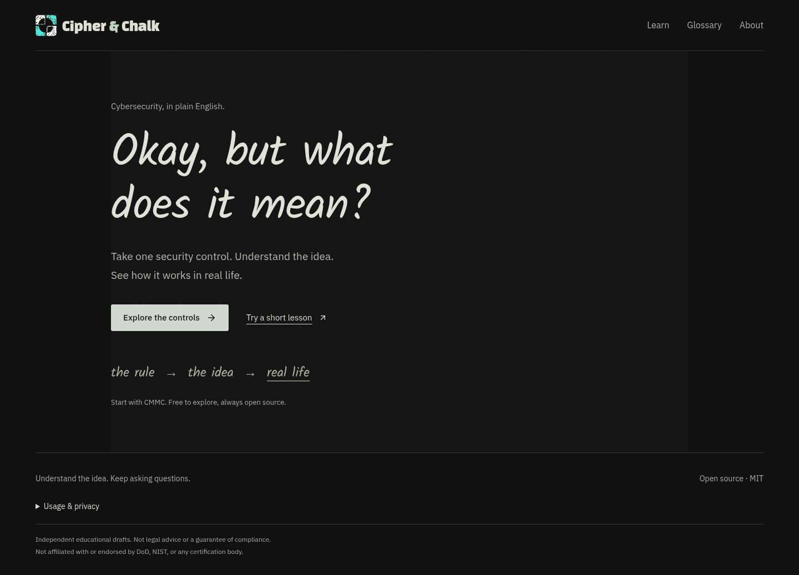
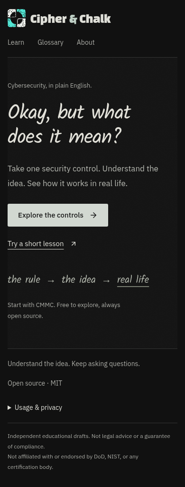

# Blackboard comfort checkpoint — October 14, 2026

The owner rejected the green canvas and crowded composition. This change follows
that feedback: matte black, softer chalk, more space and separate pages. The
supplied four-part logo stays; the earlier green visual contract is superseded.
Owner visual acceptance remains pending. PR #12 stays Draft; no merge is authorized.

[Draft PR](https://github.com/WaylandP/cipher-and-chalk/pull/12) ·
[Branch preview](https://cipherandchalk-git-feat-reference-chalkboard-waylandp.vercel.app)

The branch URL follows its latest successful deployment. The PR records the exact
commit/deployment result. Vercel preview protection requires the owner's sign-in;
local production browser checks do not establish authenticated hosted-app inspection.

## What changed

- Neutral `#111111` board, soft off-white text, quiet controls and no broad green
  surfaces. Faint grain stays on Home; lessons have solid reading surfaces.
- Short handwritten hero and one small teaching note replace the oversized diagram.
  Crisp IBM Plex Sans remains the reading/UI font. The small logo retains turquoise.
- Native Home, Learn, Glossary and About pages reduce competing content. Explicit
  Vercel rewrites support direct page entry. Historical root lesson and section links
  still work. Search terms stay in the existing Explorer URL-state contract.
- Opening a control folds filters/results away on desktop as well as phones. A
  visible button restores browsing. Source quotations, draft labels, mode keyboard
  behavior, inline definitions and practice remain available.
- Home no longer mounts an unseen control and records a false control-view event.
  Usage URLs allow only the four known public paths and strip all query/hash data.
  Production gating, opt-out, DNT, GPC and bounded event properties remain intact.
- Native page changes are document navigation; local quiz progress is not saved
  across reloads. Inline definitions let readers stay within a lesson.

## Visual evidence

The previous green design is preserved in the [earlier report](reference-visual-2026-10-14.md).

Additional actual-browser captures: [desktop reader](../screenshots/blackboard/reader-desktop.png),
[phone reader](../screenshots/blackboard/reader-phone.png),
[discovery](../screenshots/blackboard/discovery-desktop.png),
[glossary](../screenshots/blackboard/glossary-desktop.png),
[About](../screenshots/blackboard/about-desktop.png).

## Review and validation

Two bounded review/fix rounds. Independent same-harness source/visual review found
three concrete issues: a legacy hash skip-link could return Home, new analytics
paths were rejected, and a text arrow rendered as a missing glyph. The fixes use
canonical skip destinations, a strict public-path allowlist and the existing SVG icon.
New regression tests cover legacy section skips, page isolation and URL sanitization.
Existing interaction tests were moved to their actual pages without dropping behavior
assertions; navigation helper tests simulate addresses, while Chromium clicks real links.

- Application tests: **297 passed in 24 files**. TypeScript and production build passed.
- Content check: 149 references, 447 draft perspectives and 6 tooling tests passed.
- Pinned gstack installation/inventory check and 16 tooling tests passed.
- Local production Chromium captures show no horizontal overflow at 320, 390, 768,
  1024 and 1440px on Home and the reader. Discovery, Glossary and About desktop
  captures also fit. Reading tools are hidden at all five widths until requested.
- Reduced motion gives automatic scrolling; forced colors preserve keyboard focus
  on Skip to content; 200% CSS zoom fits the reader. CSS zoom is not browser-chrome
  zoom. No page errors occurred in the capture run.

Lint and repository formatting checks passed. Independent production Chromium
verification passed all five groups: native page navigation/149-reference discovery,
filters/search/level counts (15/110/24), keyboard perspectives, quiz retry/next,
inline vocabulary/Escape, clipboard confirmation, Back focus, legacy skip links,
phone layouts and preview privacy. No page/console errors were recorded. Initial
automation label/navigation-wait fixtures were corrected and rerun; they were not
application defects. Exact deployment status is recorded in the PR at publication. Original control/source files, dependency lockfile,
LICENSE and font licenses are unchanged. No content approval, Safari/screen-reader
certification, real-learner comfort result or provider analytics receipt is claimed.

## Scoped gstack methods

Unchanged pin: `945ac301a91dff5db9fc1ddaea5b77828eeca2ed` (1.91.97.0).
The current AGENTS bounded-visual rule supersedes a new product-planning or 58-skill
execution cycle. The installed design-review instructions informed the rendered
spacing, contrast, type and responsive review. Prior applicable design/browse/QA/
review instruction reads remain in conversation context; only the current changed
surfaces and interactions were rechecked. Browser automation used the pinned
Playwright dependency with isolated Chromium contexts, not personal cookies.

This is adapted/scoped design, browse, QA and code review: no full native scored,
sealed or adversarial-token report is claimed. Same-harness review is not an outside
model audit. Native discovery remains unverified. No paid providers, skill upgrades,
tunnels, artifact synchronization, merge or production deployment workflow ran.
