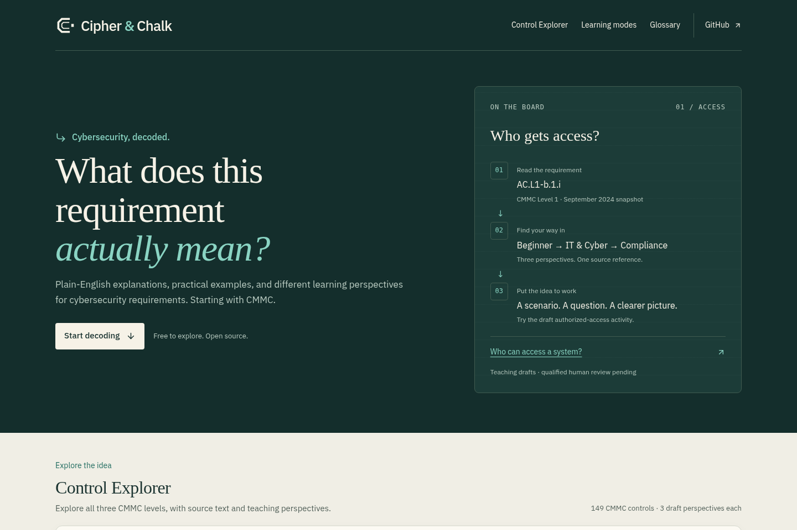

# Cipher & Chalk implementation and visual verification

The complete existing application now uses the authorized Decode Board identity:
evergreen orientation surfaces, cream reading/workbook surfaces, restrained teal,
the geometric coded-C mark and the exact display name **Cipher & Chalk**.
The [initial inventory](../designs/cipher-and-chalk.md) describes one root SPA and
its real address-driven states, rather than invented account/dashboard screens.

The owner merged the first implementation, PR [#10](https://github.com/WaylandP/cipher-and-chalk/pull/10),
at `2026-10-14T00:42:22Z`. The remaining refinements were preserved on a fresh
feature branch from that main commit and pushed in PR
[#11](https://github.com/WaylandP/cipher-and-chalk/pull/11). No agent merged, enabled
auto-merge, changed DNS/service IDs or promoted production.

GitHub subsequently reports the repository's canonical name as
`WaylandP/cipher-and-chalk`. That external change was observed through the API;
no agent renamed it. Retained historical/source/origin URLs using `Dummy-Down`
redirect to the same repository. The frontend's existing repository links retain
that redirect; deployment/project, package, storage and content IDs were not migrated.

## Inventory to delivery

All listed surfaces are implemented using the shared system. Verification below
distinguishes representative rendered checks from behavioral tests; it does not
claim every possible combination of 149 references, modes and browser settings
was inspected manually.

| Initial surface          | Implemented change                                                                                                                                | Verification                                                                                                           |
| ------------------------ | ------------------------------------------------------------------------------------------------------------------------------------------------- | ---------------------------------------------------------------------------------------------------------------------- |
| Global shell/navigation  | Coded-C live lockups, new visible/accessibility names, evergreen masthead, consistent footer and focus.                                           | Desktop/tablet/phone captures, skip link, native anchors, focus.                                                       |
| Homepage                 | Requirement-focused introduction, real default-lesson action and source-bound Decode Board illustration. Compact phone board.                     | 1440/768/375px captures; action opens the actual Level 1 identity.                                                     |
| Level navigation         | Shared paper/board styling with original edition labels and 15/110/24 totals.                                                                     | Real level links and result counts for all three levels.                                                               |
| Search/top-level choices | Native fields in shared palette, retained collection/framework choices and privacy hooks.                                                         | Topic/identifier search, collection tests and planned-catalog recovery.                                                |
| Family/level filters     | Dark discovery rail, coherent fields and readable status/count.                                                                                   | Existing filtering/regression suite; phone expansion and search.                                                       |
| Results/pagination       | Selected rail/pressed state, readable long codes/titles and shared action styling.                                                                | Level 3 dense results, narrow-width overflow checks, existing pagination tests.                                        |
| Desktop/tablet discovery | Evergreen discovery beside a cream reader.                                                                                                        | 768/1024/1440px reflow and desktop Explorer capture.                                                                   |
| Phone discovery/reading  | Reading first; Browse & filter reveals toolbar, levels and results. Selection returns to reading; Back defers search focus until visible.         | Actual 320/375px expansion, selection, heading focus and Back/search focus.                                            |
| Official control detail  | Attributed source band, readable heading/citation, consistent sharing and recovery.                                                               | Real official-source view, source disclosures and unchanged quote/data checks.                                         |
| Original demo detail     | Same identity/system, retained distinct educational-example/README context.                                                                       | Real demo address/panel and existing behavioral tests.                                                                 |
| Three perspectives       | Decode workspace, equally usable tabs, selected cue and reader-width adaptation.                                                                  | All modes, arrows/Home/End, Back/Forward and technical/compliance captures.                                            |
| Perspective feedback     | Shared actions and visible pressed/status styling.                                                                                                | Existing allowlisted-event and perspective tests; handlers unchanged.                                                  |
| Lazy perspectives        | Readable loading/failure band with real retry action; official text remains available.                                                            | Held/aborted local chunk fixtures; release/reload restores teaching.                                                   |
| Contextual vocabulary    | Inline definition/heading hierarchy and consistent source/action styling.                                                                         | Open/Close/Escape, returned focus, narrow-width definition and tests.                                                  |
| Glossary                 | Wordbook presentation, independent search, native disclosure and paper definition surface.                                                        | Actual search/open/empty states; address remains unchanged.                                                            |
| Learning introduction    | Workbook heading, concept and misconception hierarchy; accurate draft label.                                                                      | Authorized-access, public-information and media-disposal flows; focused tests.                                         |
| Instructional diagrams   | Evergreen semantic steps/destinations with explicit numbering and visible text equivalent.                                                        | Three existing diagram flows inspected; list roles/text equivalents preserved.                                         |
| Fictional scenarios      | Coherent native disclosure and ordered narrative.                                                                                                 | Actual disclosure flows and Level 1 tests.                                                                             |
| Questions/progress       | Native radio/fieldset semantics, selected text cue, question-position meter, outcome words/icon, answer recap and explanation before advancement. | Wrong/right, retry, next, completion/reset, focus and phone capture; 2 added outcome tests.                            |
| Session learning state   | Existing exact-identity reset/perspective persistence retained.                                                                                   | Actual mode change preserves open activity; identity/reset and lifetime tests.                                         |
| Review/objectives        | Consistent disclosures, review stages and visibly pending qualified approval.                                                                     | Actual source/review opens; unchanged records and review tests.                                                        |
| Source/model disclosures | Native markers and shared typography/links; no quotation or source URL rewrite.                                                                   | Actual source context; comparison/source integrity tests.                                                              |
| Sharing                  | Coherent idle/pending/copied/fallback styling and readable selectable URL.                                                                        | Native Chromium copy succeeded without reading clipboard; injected denial/fallback at 320px; async lifetime tests.     |
| Empty/recovery states    | Shared paper status surface and real recovery actions.                                                                                            | Empty search, planned framework, invalid/missing lesson, invalid mode, excluded reference and denied-history fixtures. |
| Footer/privacy           | New live brand, preserved native disclosure marker and consent/browser-preference protections.                                                    | Normal-color phone capture, opt-out, native marker, privacy/SDK/event tests.                                           |

No existing dialog or account menu was found. Native selects, disclosures and
inline definitions were styled and tested; no extra modal or navigation capability
was invented to satisfy conceptual reference text.

## Checks and browser evidence

At frontend commit `75726def64038e5b061c148bec621ccf48956de4`, typecheck, ESLint,
Prettier, **280 Vitest tests in 23 files**, and production build passed. Content
inventory plus **6 Node content regressions** and the pinned workflow registry plus
**16 Node workflow regressions** also passed during the implementation checkpoint.
Later documentation/screenshots do not change the validated frontend bytes.

Actual Chromium inspection used the existing Vite development server and a local
production build, with isolated browser contexts and no personal sessions. The
coordinator's nine journey groups and five synthetic recovery groups passed:
homepage/metadata/navigation; all levels; search/control/modes/history;
questions/retry/next/completion/reset; diagrams/vocabulary/source/glossary;
empty/planned/invalid/unavailable recovery; 320/375/768/1024/1440px layouts;
reduced motion/forced colors/keyboard/zoom; and privacy/opt-out. Recovery fixtures
held/aborted only the local teaching chunk or deliberately denied browser clipboard
and history operations. Those expected fixture errors are separate from application
errors; successful normal journeys had no page errors.

Two automation selectors initially targeted multiple/hidden definition disclosures,
and an initial clipboard assertion read before its asynchronous result. They were
corrected with scoped selectors/awaited status; their local partial runs remain
preserved. No application change was made to disguise those automation failures.

Visual inspection found and repaired two actual style issues: crowded tabs under
200% CSS zoom and a selected-answer selector overriding an incorrect-outcome border.
Final screenshots and physical bounding checks verify the repairs. CSS zoom is
explicitly a browser-rendered CSS zoom check, not browser-chrome zoom. Narrow
viewport reflow was checked separately. Native disclosure indicators, visible
focus and forced-color tabs remained usable. Token contrast samples are:

| Pair                                               |  Contrast ratio |
| -------------------------------------------------- | --------------: |
| Reading text / paper                               |         12.69:1 |
| Reading muted / paper                              |          6.23:1 |
| Reading accent / paper                             |          5.87:1 |
| Board text / board                                 |         12.89:1 |
| Board muted / raised board                         |          7.06:1 |
| Board accent / board                               |          8.43:1 |
| Error text / paper                                 |          7.27:1 |
| Light and dark field outlines / respective surface | 3.56:1 / 3.36:1 |

These are sampled rendered palette relationships, not a complete WCAG conformance
assessment. Screen-reader, Safari/iOS and real-learner testing remain pending.

The scoped teaching worker used the pinned gstack guard/checkpoint method and
retained 43 checkpoint links, 44 dispatches and 11 viewed screenshots. Public asset
edits invalidated a development quiz fixture; two timeouts were retained before a
fresh fixture passed the same Check action. The original timer was not reset.
Its formal browser evidence materializer returned **INCONCLUSIVE — no evidence
rows** for the prescribed browser-only `evidence: []`. This verdict is retained;
observed UI successes do not become a full gstack QA pass. See the
[58-skill record](cipher-and-chalk-gstack-2026-10-14.md) for native reviewer/tool
blockers and exact coverage limits.

## Screenshots of implemented screens

All images below were captured from the actual application and viewed. The logo
sheet is a separate asset proof, not an invented app route. The loading/error and
clipboard fallback images use the documented local failure fixtures. Some retained
captures precede the narrow-tab/border fix but show unaffected surfaces; final zoom,
reader and question images show the repaired styles.

| View                          | Capture                                                                                                                       |
| ----------------------------- | ----------------------------------------------------------------------------------------------------------------------------- |
| Homepage, desktop             | [Open](../screenshots/cipher-home-desktop.png)                                                                                |
| Homepage, tablet              | [Open](../screenshots/cipher-home-tablet.png)                                                                                 |
| Homepage, phone               | [Open](../screenshots/cipher-home-phone.png)                                                                                  |
| Explorer, desktop             | [Open](../screenshots/cipher-explorer-desktop.png)                                                                            |
| Reader, phone                 | [Open](../screenshots/cipher-reader-phone.png)                                                                                |
| IT & Cyber / Compliance       | [Technical](../screenshots/cipher-technical-perspective.png) · [Compliance](../screenshots/cipher-compliance-perspective.png) |
| Question feedback, phone      | [Open](../screenshots/cipher-question-phone.png)                                                                              |
| Diagram / glossary            | [Diagram](../screenshots/cipher-diagram.png) · [Glossary](../screenshots/cipher-glossary.png)                                 |
| Empty results                 | [Open](../screenshots/cipher-empty-results.png)                                                                               |
| Loading / failed teaching     | [Loading](../screenshots/cipher-loading.png) · [Failure](../screenshots/cipher-load-error-phone.png)                          |
| Sharing fallback              | [Open](../screenshots/cipher-sharing-fallback-phone.png)                                                                      |
| Usage/privacy, phone          | [Open](../screenshots/cipher-privacy-phone.png)                                                                               |
| Zoom / forced colors          | [CSS zoom](../screenshots/cipher-zoom-200.png) · [Forced colors/focus](../screenshots/cipher-forced-colors.png)               |
| Logo, 16/32/40px and app icon | [Asset proof](../screenshots/cipher-logo-sizes.png)                                                                           |

## Preserved boundaries and remaining review

Compared with the pre-redesign baseline, all official catalog/quotation,
perspective, activity, glossary and review data remain byte-identical. The only
data-file change renames the archived project README display citation; its pinned
URL is unchanged. Framework/edition/control identities, history implementation,
analytics collection/privacy code, package/lockfile, LICENSE and third-party notices
are unchanged. The MIT LICENSE SHA-256 remains
`b160b491b47f34e5505f6d50d4702daaebf401c6bdfd8009b2b4e82208dd41e9`.

The refined reference image was absent from the text attachment. This is an
implementation of the authorized written Decode Board direction, with no inspected
image/pixel-match claim. Qualified content approval and current applicability
remain pending; the redesign does not provide certification or assessment readiness.

GitHub CI and Vercel succeeded for the frontend commit. The preview requires Vercel
SSO (a verified HTTPS HEAD returned 302 to the sign-in endpoint); hosted application
inspection was not bypassed. Use the feature PR's successful preview while signed
in as the project owner. Local production-browser validation is distinct from
hosted end-to-end verification and field performance.
