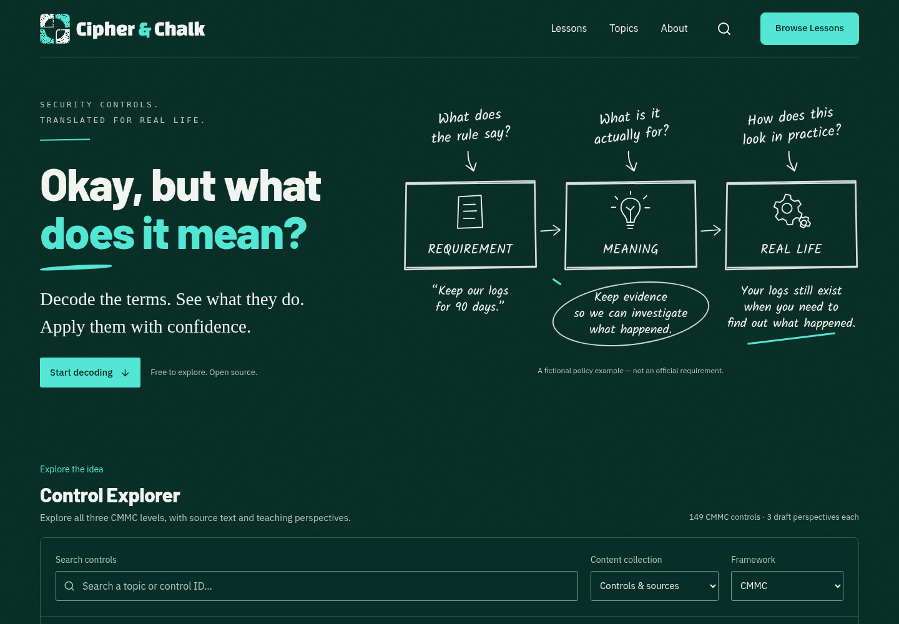

# Cipher & Chalk: reference visual checkpoint

October 14, 2026 · `feat/reference-chalkboard` · base main `d4a9ccd`.
**Draft preview checkpoint. Owner feedback required; do not merge yet.**
[Draft PR #12](https://github.com/WaylandP/cipher-and-chalk/pull/12) ·
[Branch preview](https://cipherandchalk-git-feat-reference-chalkboard-waylandp.vercel.app) ·
[Immutable frontend preview](https://cipherandchalk-elb6z3t63-waylandp.vercel.app).

Vercel deployment `7054931715` succeeded for frontend commit
`7ee71a011510310528297ed67316ce825e300507` at 02:04:45 UTC. The preview responds
HTTP 302 to Vercel sign-in (`vercel.com/sso-api`); protection remains enabled.
Deployment success and local production-browser checks are verified; the hosted
application behind sign-in was not browser-inspected. Subsequent documentation
updates do not change this frontend. The branch preview follows the latest push.

The owner supplied the full Decode Board image and then the separate square logo.
Both were inspected before changing the UI. Their [brief and provenance](../design-references/README.md)
supersede the earlier text-only interpretation. Before captures came from the
unchanged main application; after captures came from the actual local production
build. They are not mockups or screenshot backgrounds.

## Before and after

| Defining feature  | Before                            | Implemented correction                                                                                     |
| ----------------- | --------------------------------- | ---------------------------------------------------------------------------------------------------------- |
| Mark              | Generic open C/code segment       | Alternating white/turquoise curved quadrants with negative-space circle and worn SVG treatment             |
| Wordmark          | IBM Plex medium                   | Heavy Changa One, off-white words/turquoise ampersand                                                      |
| Headline          | Georgia and italic teal phrase    | Upright Barlow 800, exact “Okay, but what / does it mean?” copy, turquoise second line and chalk underline |
| Material          | Flat slate hero, cream reading UI | Deep green board, faint static grain, solid dark green learning/reading surfaces                           |
| Hero diagram      | Stacked interface cards           | Three chalk frames, hand-drawn document/lightbulb/gears, handwritten questions/arrows/circled meaning      |
| Navigation        | Old feature labels                | Working Lessons, Topics, About, Search and Browse Lessons; no empty Stories page                           |
| Teaching surfaces | Cream examples and quizzes        | Consistent dark palette with clear source, draft, selected, correct/incorrect and recovery states          |

| View         | Before                                                | After                                               |
| ------------ | ----------------------------------------------------- | --------------------------------------------------- |
| Desktop 1440 | [Before](../screenshots/reference/before-desktop.png) | [After](../screenshots/reference/after-desktop.png) |
| Phone 390    | [Before](../screenshots/reference/before-390.png)     | [After](../screenshots/reference/after-390.png)     |
| Phone 320    | [Before](../screenshots/reference/before-320.png)     | [After](../screenshots/reference/after-320.png)     |
| Tablet 768   | —                                                     | [After](../screenshots/reference/after-tablet.png)  |

Additional actual screens: [phone lesson](../screenshots/reference/reader-390.png),
[Level 3 perspective](../screenshots/reference/level3-perspective.png),
[quiz feedback](../screenshots/reference/quiz-feedback.png),
[existing lesson diagram](../screenshots/reference/lesson-diagram.png),
[glossary](../screenshots/reference/glossary.png),
[phone privacy](../screenshots/reference/privacy-390.png),
[empty results](../screenshots/reference/empty-results.png),
[200% CSS zoom](../screenshots/reference/zoom-200.png),
[forced colors](../screenshots/reference/forced-colors.png).

## Brand delivery and remaining visual decisions

[Brand proof sheet](../screenshots/reference/brand-assets.png),
[scalable mark](../../public/brand/chalk-mark.svg),
[outlined lockup](../../public/brand/lockup.svg),
[app icon](../../public/brand/app-icon.svg),
[PNG touch icon](../../public/apple-touch-icon.png),
[favicon](../../public/favicon.svg).

The full image is a presentation with a website below it; the top specimen and
“2 THE DECODE BOARD” title are intentionally not website sections. The website
continues into the real existing Explorer, absent from the supplied mockup.

Remaining differences for owner judgment:

- Changa One has rounder, less chamfered letterforms than the reference wordmark.
  It is a verified freely licensed approximation, not an identified exact font.
- The logo geometry was drawn from the visible square reference. Its procedural
  wear, cleaner diagram strokes and faint board grain approximate the supplied
  organic scratches. Original PNG bytes were not exposed as a workspace file or
  downloadable ID; no exact original asset or pixel-perfect reproduction is claimed.
- Phones use a readable stacked teaching flow; tablet copy and drawing occupy
  separate rows. The reference supplies no mobile layout.
- Stories has no real destination and is omitted. Topics leads to the real glossary.
  A real Start decoding action and a visible fictional-policy caption were added.
  “Keep our logs for 90 days” is explicitly an illustration, never official CMMC text.

## Two visual review/fix rounds

1. Compared 1440/390/320 home and Explorer with both supplied images. Corrected
   joined words caused by hidden mobile line breaks, a wrapped mobile Browse
   button and over-strong grain. Inspected the logo, outlined lockup and 16/32px favicon.
2. Compared the updated home/reader and 768px tablet. Fixed cramped tablet notes by
   giving copy and drawing separate rows from 761–1000px. Re-rendered and inspected
   the fix. This is the final bounded visual checkpoint; further stylistic
   refinements wait for owner feedback.

An existing heading assertion caught missing inter-element whitespace in the new
headline. Fixed the markup and updated the two assertions that named the old
headline. Assertions and behavioral coverage were not removed or weakened.

## Validation

- `npm run typecheck`, `npm run lint`, `npm run format:check`, `npm test`,
  `npm run build`: passed. **280 application tests in 23 files**.
- `npm run check:content`: passed 149 references/447 perspectives and 6 tests.
  `npm run check:gstack`: passed 16 tooling tests. Installed pin check passed.
- Actual Chromium: 1440/768/390/320 captures, plus no horizontal overflow at
  320/390/768/1024/1440; owned isolated contexts, no personal cookies.
- Lessons/Browse reach 149 references. Search navigation focuses the input and
  “public information” returns 2 references. Topics/About reach the actual sections.
- All levels return 15/110/24. Selected-control modes work with End/ArrowLeft/Home;
  phone tabs fit and Back to results restores search focus.
- Terms open and Escape restores focus. Existing scenario/diagram, wrong answer,
  retry, right answer and next-question transitions work. Native clipboard write
  reports “Reference link copied.” Clipboard content was not read.
- Empty-search recovery, glossary search, privacy disclosure and preview collection
  disabled state verified. Final browser checks recorded no page/console errors.
- Reduced-motion scroll behavior, visible forced-color skip-link focus, and reader
  tab physical bounds at 200% CSS zoom passed. CSS zoom is not browser-chrome zoom.
- Sample contrast: body 13.10:1, muted on raised 7.47:1, turquoise on raised 8.45:1,
  error on reader 8.35:1, field boundary 4.84:1. These samples do not certify WCAG.

Initial browser automation used incorrect expected anchors/strings and omitted
selecting a level result before looking for tabs. Those fixtures were corrected
against real DOM/state, and the affected flows reran successfully. No application
failure was inferred from those setup mistakes. Retained private evidence:
`/tmp/reference-final-qa/rechecked/results.json`, `remaining/results.json`,
`/tmp/reference-round2/accessibility.json` and corresponding screenshots.

Source data, official quotations, framework/edition/control identities, URL state
logic, analytics protections, package dependencies/lockfile, LICENSE and existing
font notices have no diff. New local fonts add SIL OFL notices and source checksums.
No new controls, invented curriculum, paid services, accounts or production changes.
Screen-reader, Safari/iOS, real-learner and qualified content review remain pending.

## Scoped gstack use

Pin: `945ac301a91dff5db9fc1ddaea5b77828eeca2ed` (1.91.97.0), unchanged.
Actual installed instructions and applicable sections were read for:

| Skill               | Applied scope and honest limit                                                                                                                                                                                                                     |
| ------------------- | -------------------------------------------------------------------------------------------------------------------------------------------------------------------------------------------------------------------------------------------------- |
| design-consultation | Reference-constrained identity, verified fonts/licenses, palette, responsive and accessibility decisions. No alternate moodboards or fresh product-direction interview; the owner explicitly fixed the design.                                     |
| plan-design-review  | Seven-dimension review of navigation, states, journey, reference-specific identity, system consistency, responsive/accessibility and unresolved choices. No complete native scored report, sealing or approval log claimed.                        |
| design-review       | Rendered before/after comparison, same-harness independent review and two bounded fix rounds. No full detector baseline, grading or 11-phase certification.                                                                                        |
| browse              | Original compiled pinned browser for baseline and final snapshots/captures; isolated Playwright from its retained dependency for bounded flows and responsive checks.                                                                              |
| qa                  | Six scoped production-browser groups with corrected-fixture rechecks. Adapted execution; native Write/ordered sealed report materialization not completed. No full formal QA pass claimed.                                                         |
| review              | Scoped changed-source and visual review; retained state/privacy/content boundaries checked. No native bound adversarial token or full review gate receipt. Same-harness worker review is not an independent external-model/security certification. |

The supplied brief overrides generic design patterns and broad 58-skill routing.
No unrelated product planning, external paid reviews, cookies, tunnels, skill
upgrades, artifact sync or deployment/merge skill was invoked. Feature publication
is directly authorized by the owner. The PR remains Draft for feedback.
