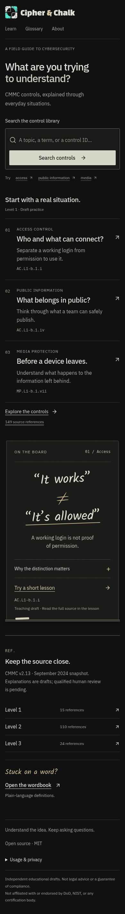

# A useful reference desk — October 14, 2026

The owner found the previous blackboard pass generic and lacking structure. Its
large handwritten introduction occupied the page while actual help was hidden
behind links. This revision changes the homepage's job: find a control, open a
real learning situation, or understand one specific distinction immediately.

[Draft PR #12](https://github.com/WaylandP/cipher-and-chalk/pull/12).
The PR records the exact successful Vercel preview after publication. Owner visual
acceptance is pending; no merge or production promotion is authorized.

## Design decisions

A continuous ruled index replaces the empty hero composition. A clear question and
native search appear first. Three numbered rows lead to existing draft activities:
authorized access, public information and media disposal. A single chalkboard
explains “It works” does not mean “It’s allowed”; its expandable explanation comes
from the existing, publication-bound learning draft. It links to the full source
and practice instead of inventing a control quotation or new curriculum.

The board's worn surface, hand-drawn distinction, muted chalk and small chalk ledge
provide the theme. The rest stays matte black and typographic. IBM Plex is used for
navigation and reading, Kalam for teaching/marginal notes, Changa for the supplied
mark's wordmark. A restrained ochre replaces the sage interaction accent. No large
green surface, decorative card grid, stock illustration, animation or new font was
introduced. Small new labels are at least 12px; lesson-row descriptions are 16px.

Home, library and footer share a 1160px maximum grid. Phones put search and the
three topic rows before the teaching board. Library, glossary and About inherit
consistent typography, spacing and warm focus/selection cues. Reader shortcuts
link to Source, Explain it and, only where available, Practice. Unique focusable
anchor targets keep keyboard navigation within the lesson. Existing local answers
remain intact during perspective/anchor changes; cross-page progress is not saved.

Native homepage search uses the established discover/references/CMMC URL contract.
It reports only the existing bounded search-used fields, never the query text.
Home still does not mount an unseen lesson. Production gating, opt-out, DNT/GPC,
URL sanitization, source quotations and pending human-review labels are preserved.

## Actual screens

[Previous blackboard](blackboard-comfort-2026-10-14.md) provides the comparison.

[Reader desktop](../screenshots/study-desk/reader-desktop.png) ·
[Reader phone](../screenshots/study-desk/reader-phone.png) ·
[Library](../screenshots/study-desk/library.png) ·
[Glossary](../screenshots/study-desk/glossary.png) ·
[About](../screenshots/study-desk/about.png)

## Review and validation

Independent source/content navigation review mapped all three entries to real
activities, checked the URL parser and identified analytics boundaries. Independent
visual critique recommended useful search, a ruled index and one genuine teaching
example. The first rendered review led to a functional headline, shorter
introduction and a scoped fix for a mobile heading rule that enlarged the board
label. An early stylesheet-order problem was corrected by importing component
styles centrally after Tailwind's layer declaration. No screenshot with that
problem is used as final evidence.

- **313 application tests in 26 files passed.** New tests exercise actual search
  parsing/results, encoded text, bounded telemetry, all three full lesson
  identities, level counts, the real draft disclosure and reader targets/state.
- TypeScript and production build passed. Content inventory check and its six
  tests passed; 16 gstack tooling tests and the pinned installation check passed.
- Production Chromium captures show no horizontal overflow on Home/reader at
  320, 390, 768, 1024 and 1440px, or desktop Library, Glossary and About.
- Reduced motion restores automatic scrolling; forced colors preserve Skip focus;
  200% CSS zoom fits Home. CSS zoom is not browser-chrome zoom.
- Independent production-browser checks cover native Enter searches, topic links,
  15/110/24 level counts, all three starter activities, glossary/back, keyboard
  perspectives, wrong/retry/correct/next, clipboard feedback, reader-anchor focus
  without losing question position, legacy links and preview privacy.
- Capture and independent browser runs reported no page errors. Final lint/format,
  GitHub CI and exact Vercel status are recorded in the PR at publication.

Automation fixtures were corrected for the existing quiz disclosure and smooth
scrolling before asserting target positions. A partial headline edit was caught by
an existing page test and fixed; assertions were retained. Two local URL helpers
were made private to satisfy the React fast-refresh lint rule. No production bug
was hidden by skipping a check or weakening an assertion.

Original curriculum/source files, package dependencies, lockfile, LICENSE and font
licenses are unchanged. This work does not verify current CMMC applicability,
provide qualified content approval or prove returning-user behavior. Safari,
screen-reader and real-reader comfort review remain pending.

## Scoped gstack use

Pin remains `945ac301a91dff5db9fc1ddaea5b77828eeca2ed` (1.91.97.0).
Installation/inventory verification passed; native discovery remains unverified.
The existing bounded visual-task rule applies rather than a fresh 58-skill cycle.
Actual installed design-review usability, hierarchy, typography, anti-template,
read-surface and responsive guidance was read and applied. Independent same-harness
review and real Chromium checks supply the evidence above. The browser used the
pinned Playwright dependency and isolated contexts, without personal cookies.

These are scoped/adapted design, browser, QA and code-review methods. No full native
scored/sealed report, external-model review or complete skill-pass claim is made.
No paid provider, new installation, tunnel, artifact synchronization, merge or
production workflow was invoked. Two visual review rounds end at a validated Draft
preview for the owner's judgment.
